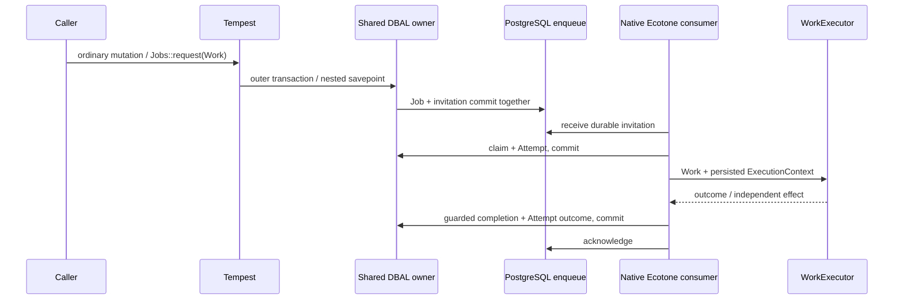

# Ecotone Operations foundation

**Decision: Adopt for the pre-release application using the pinned development
fork and reproducible Ecotone patches below.** Upstream releases are not a
prerequisite for this branch. This is a replacement foundation, not a migration
of existing installations. There is no old-message conversion or dual transport.
The implementation is submitted for review in PR #80 on spike/ecotone-evaluation.
Verification provenance is recorded against the pre-change base and source hashes.

This report supersedes the earlier evaluation recommendations. Earlier evidence
JSON remains historical, pinned to its own source commit; the prior implementation
and reports can be inspected at `56026a2`. The current source and current verification
results, not those historical reports, define the replacement's claims.

## Actual application architecture

Normal Tempest boot resolves DatabaseConnectionInitializer, selecting the proposed
library-owned Ecotone Api Tempest DbalBackedConnection from Tempest DatabaseConfig.
The official TempestConnectionReference reuses that object's DBAL owner. Ordinary
persistence remains Tempest Database; no general-purpose Doctrine application
repository layer or ORM is added.

Jobs::request retains canonical Work admission and generation-based queued
promotion. JobRuntime receives the shared Connection, native CommandBus and optional
departmental WorkExecutor through normal DI. It builds no container, bus, transport,
sender or worker. OperationsMessaging is a native ServiceContext configuration.
ConfiguredMessagingSystem runs the real asynchronous handler.



The consumer does not wrap external effects in one long transaction. Short claim,
failure/retry and completion transactions are application domain policy. A valid
busy claim creates a delayed invitation and returns without consuming domain
failure budget. Obsolete generations and terminal Jobs are discarded safely.

Infrastructure failures use native delayed retries and dead letters. A transport
failure does not manufacture an Attempt failure or Job failure. Native replay
preserves Job identity and retains its dead letter when enqueue fails. Domain
handler failures have a distinct persisted three-failure budget and Attempt history.

## What disappeared and what remains

| Existing architecture / evaluation component | Final replacement |
| --- | --- |
| Messenger MessageBus, sender/handler locators, anonymous JobServices, transport construction | Official framework-managed ConfiguredMessagingSystem and CommandBus |
| OutboxSender, relay, envelopes and stamps, intermediate jobs/jobs_interactive forwarding queues | One native jobs channel with native priority; no forwarding hop |
| Messenger worker listener/dispatcher assembly, retry/failure listeners | Native polling, delayed retries and DBAL dead letters |
| FailedMessageRepository and job:retry-message redispatch | Native deadletter list/show/replay commands |
| messenger_messages migration schema | Removed; clean databases provision enqueue and ecotone_error_messages |
| SharedOperationsConnection, SharedPostgresConnection, TempestDbalConnection | Removed from Stashd; library-owned injected connection/driver/close guard |
| OperationsConnectionInitializer and JobRuntimeInitializer | One small DatabaseConnectionInitializer; ordinary DI handles the domain runtime |
| JobRuntime's EcotoneLite bootstrap and work()/messaging() assembly | Removed; native configuration and ecotone:run |
| DeliverySchema / job:setup wrapper | Removed; native database setup command/API |
| Separate official-test Composer application and custom bridge profiles | Removed; all integration contracts boot the actual application |
| Messenger-only acceptance drivers, relay supervisor and fault commands | Removed; native PostgreSQL/process fixture with independent SQL/effects |
| Work identities, Jobs, Attempts, desired priority, generations, claim leases | Remain application-owned and persisted |
| PostgreSQL advisory identity locks, partial active-Work index, conditional finalization | Remain domain concurrency operations |
| Department reconciliation, resource/execution policy and fencing obligations | Remain department/Operations responsibilities; no new scheduler or OPS-C03 implementation |
| Vault/OCFL authority, catalogue metadata/PREMIS classifications | Remain separate from delivery and unchanged |

Core directly removes symfony/messenger, symfony/doctrine-messenger,
symfony/event-dispatcher and symfony/console. Console/event-dispatcher remain
transitively where libraries require them; their presence is not a Messenger
runtime. It adds ecotone/tempest and cweagans/composer-patches. DBAL remains an
accepted direct dependency and Ecotone dependency. There is no installed Messenger
package or Doctrine ORM. The lockfile records the complete transitive graph.

This reduces responsibilities, not just local lines: there is one delivery hop,
one supervised Operations process role, one connection owner and no Stashd runtime
assembly. The shared-connection responsibilities still exist in the proposed
library patch. Three local Ecotone patches and an unreleased Tempest fork are an
explicit maintenance cost; moving code upstream is not counted as its disappearance.
No throughput/CPU benchmark or general resource-cost superiority is claimed.

## Development dependencies and bootstrap requirements

The authoritative pins and patch checksums are composer.lock, patches.json and
patches.lock.json. Composer Patches applies local checksum-locked files on install;
there are no unexplained manual vendor changes. Git is required during dependency
build. The Tempest dependency is the actual hipsterjazzbo/tempest-framework fork,
branch fix/2325-injected-connections at
`5e56e440298e4c30e8059030ef078e7a71e4fbf6`, aliased as 3.19.2 solely to satisfy
Ecotone's constraint. The alias is not a released guarantee.

- ecotone/ecotone, dbal, enqueue and tempest: 2.0.0-beta.7.
- doctrine/dbal: 4.5.0; cweagans/composer-patches: 2.0.0.
- The fork requires nette/php-generator 4.2.3.
- Existing advisory fixes also update symfony/mime to 8.1.10, Pest to 5.3.4,
  PHPUnit to 13.4.5, ParaTest to 7.27.5 and its required git-state helper to 1.1.0.
- `ecotone-tempest-injection.patch`: library-owned Tempest Connection, original
  DatabaseConfig/PDO driver, transaction-close guard, and resolver reuse of the
  one DBAL owner. It also exposes native connection settings so visibility is
  deliberately configured at 60 seconds rather than the factory's default.
- `ecotone-dbal-priority.patch`: copies outbound priority into the native message.
  Its failing negative control is retained. Interactive preference is not FIFO or
  starvation-freedom, and does not preempt an already running Attempt.
- `ecotone-tempest-lazy-boot.patch`: avoids compiling messaging for ordinary
  concrete/unrelated interfaces, supports console-prefix discovery, skips CLI
  discovery during HTTP boot, and namespaces/clears caches by application root.

The Tempest fork alone does not fix the official adapter's transaction ownership.
Sharing PDO with a separate DBAL nesting counter fails inner admission. The injected
path instead updates one counter and uses real savepoints. Stashd requires that
binding; it has no fallback to the original reflection-based PDO bridge. The
official package still contains its old path for other users, but Stashd does not
execute it. No private PDO property is reflected into by the replacement.

Supported Tempest discovery filters keep Ecotone's internal Config/driver and Api
classes out of Tempest's general service discovery; Ecotone loads those itself.
Without those filters and lazy adapter resolution, installing the integration broke
the existing 32 MiB archive CLI contracts. They now pass unchanged, including the
large binary streaming and HTTP tests. This is a documented configuration choice,
not a higher memory cap or preservation implementation change. Revisit when the
upstream package exposes only its integration hooks to Tempest discovery.

The active channel, retry, dead-letter and integration code paths carry Apache-2.0
or MIT notices and run without an Enterprise key. Ecotone packages also contain
proprietary features; their package licence declaration is not blanket permission
to use every module. No Enterprise workflow, saga orchestration, dynamic routing
or instant command retry capability is adopted or evaluated here.

## Installation, consumers and recovery

```sh
lerd composer install --no-interaction
# Application environment (use the repository/Lerd console entry point locally):
php tempest integration:init
php tempest ecotone:migration:database:setup --initialize
php tempest ecotone:run jobs --memoryLimit=256 --executionTimeLimit=300000
php tempest ecotone:deadletter:list
php tempest ecotone:deadletter:show MESSAGE_ID
php tempest ecotone:deadletter:replay MESSAGE_ID
```

The PostgreSQL database and restricted owner must exist. Application migrations
create the private schema/domain tables; native setup provisions only used queue
and dead-letter features, without deleting intent. No historical upgrade is
needed. Schema is a PostgreSQL startup option in Tempest DatabaseConfig so it
survives reconnect; a conflicting independent DSN options field is rejected.
Nonpersistent connections are process-local. Connection replacement during an
active shared transaction is rejected, including direct DBAL close.

Supervise one or more native jobs consumers, restarting on exit. No relay or
priority-specific worker is required. Tempest retains scheduling. Stop consumers
before code/payload or cache changes, install locked dependencies/patches, migrate,
provision/warm once, and restart. Caches contain definitions, not a reusable physical
connection. Production-cache tests exercise fresh processes against two independent
installations without sharing their Jobs or effects. Other dialects and tenant
switching are not certified by this PostgreSQL proof.

See ../development/jobs.md for startup/recovery details and
../development/work-admission.md for Work and departmental reconciliation policy.

## Executable contracts and evidence

The complete retired-test-to-native-proof mapping is in
[durable-delivery.md](../development/durable-delivery.md). OPS-C01 assertions remain
unchanged. The original Messenger-only OPS-C02 observations are replaced by native
failure observations; no case is skipped, made incomplete or declared green merely
because relay machinery disappeared.

The actual integration proves ordinary mutation + Job + invitation commit/rollback,
nested savepoint failure with usable outer work, physical PostgreSQL PID/transaction
identity, both initialization orders, reconnect guards, non-default schema,
production cache isolation, idempotent provisioning and clean installation.
The four previously retained red gates now run against the real application binding.

Fault tests cover concurrent coalescence, Refresh/Complete identity, queued promotion,
new Work after terminal completion, precommit death, restart after commit, receipt
and claim death, completion-before-ack death at the actual native DELETE,
duplicates/obsolete generations, busy recovery, truthful domain failures, infrastructure
retry exhaustion/dead letters, native operator replay, rejected busy/retry publication
and delivery reordering.
The separate catalogue proof delivers one existing event through the same native
system to independent history/PREMIS/client consumers, preserving its ID and safe
projection. It is not a canonical Vault PREMIS implementation or migration of all
catalogue events.

```sh
lerd composer qa
STASHD_TEST_PROCESSES=1 ./bin/test.sh tests/Acceptance/Operations tests/Acceptance/OperationsDelivery tests/Acceptance/EcotoneDelivery tests/Acceptance/EcotoneInstallation tests/Acceptance/Integration/JobsTest.php tests/Acceptance/Integration/WorkAdmissionAtomicityTest.php tests/Acceptance/Integration/WorkExecutionContextTest.php tests/Feature/EcotoneTransactionTest.php --log-junit tmp/ecotone-replacement-focused.xml
python3 -B -m unittest discover -s tools/verification -p 'test_*.py'
python3 -B tools/verification/ops_c02_negative.py
python3 -B tools/evaluations/installation-negative.py
lerd composer audit
```

Final results are recorded in
[ecotone-replacement-evidence.json](ecotone-replacement-evidence.json), including
exact dependency additions/removals, patch hashes and verified source hashes.

| Verification | Observed result |
| --- | --- |
| Complete canonical `lerd composer qa` | Exit 0; 478 passed, 33 existing incomplete preservation contracts, zero failures; 24,388 assertions, 116.83 seconds, four processes |
| Focused Operations, delivery, installation and catalogue contracts | 38 passed, zero incomplete/failures; 1,065 assertions, 90.48 seconds, serial |
| Native delivery adversarial verification | Passing ten-case baseline, nine intended invariant failures, exact source restoration, passing restored suite |
| Nested transaction adversarial verification | Passing baseline, three intended invariant failures, exact source restoration, passing restored test |
| Python verifier/wrapper regressions | 13 passed |
| Mago format, lint and analysis | Passed; analysis retains three pre-existing Records & Archives help diagnostics |
| Composer audit / validate | No advisories or abandoned packages; valid with deliberate development-pin warnings |
| Isolation and cleanup | Six other worktrees match saved status/diff/dirty-file hashes; fixture database, role, directory and child cleanup asserted |

A broad initial nesting sabotage failed during fixture migrations and was rejected
as a verification error. The retained control targets the actual nested test only.
Similarly, the transport publication fault uses a BEFORE INSERT trigger so receipt
can succeed before retry publication is rejected. Neither fixture errors nor those
initial runs are counted as successful negative controls. All retained controls
have passing restored baselines. The four previously red acceptance gates pass;
there are no expected-failing replacement gates.


The full-suite exception is the existing independently incomplete preservation
contracts and known test-environment deprecations. No intentional red acceptance
case is accepted as a green build. Negative verification requires passing baseline,
precise assertion failure, independent persisted observations, exact source
restoration and a passing restored suite. Setup errors and timeouts never count.
The original verifier's classifier/restoration regressions were carried forward
and extended for native failures and the canonical POSIX test wrapper.

## What we would never have needed

Selecting Ecotone first would have avoided the Messenger sender/locator/listener
assembly, local outbox relay, separate forwarding/interactive destination queues
and failed-envelope redispatch command. Framework-managed messaging, retries and
native PostgreSQL delivery provide those responsibilities directly.

Shared transaction integration would still have required work: Ecotone alone does
not fix Tempest injection or coordinate two transaction counters. The fork and
adapter changes are the demonstrated solution. With that integration there is no
permanent separate Operations persistence runtime to maintain.

We would still need canonical Work identities, coalescence, queued promotion policy,
Jobs, actual Attempt history, claim generations and leases, guarded state transitions,
department executors, resource policy, reconciliation and independently tested crash
behaviour. Database provisioning, worker supervision, cache/deployment discipline
and upstream integration maintenance also remain. Vault authority, custody, fixity
and recovery remain preservation responsibilities regardless of messaging choice.

## Proof limits

An independent effect can happen before completion persistence fails. The acceptance
suite deliberately observes its repetition after recovery; arbitrary external
exactly-once effects are not guaranteed. Job completion fencing does not fence a
live stale worker's external effects. OPS-C03 fencing/lease renewal, cancellation,
remote brokers, power/storage failure, total network partitions, tenant switching,
other database engines and comprehensive workflow orchestration remain unproved.
No preservation code or protected preservation assertion is changed.
