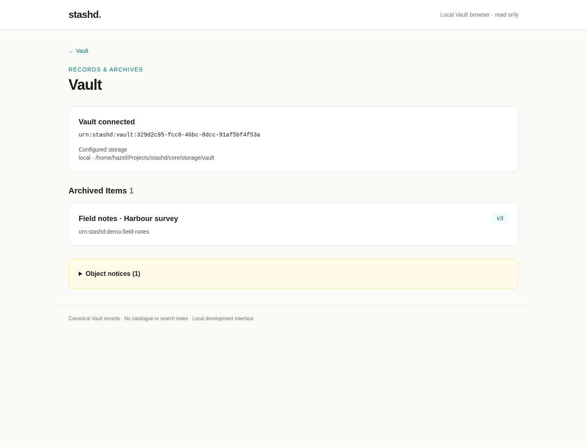
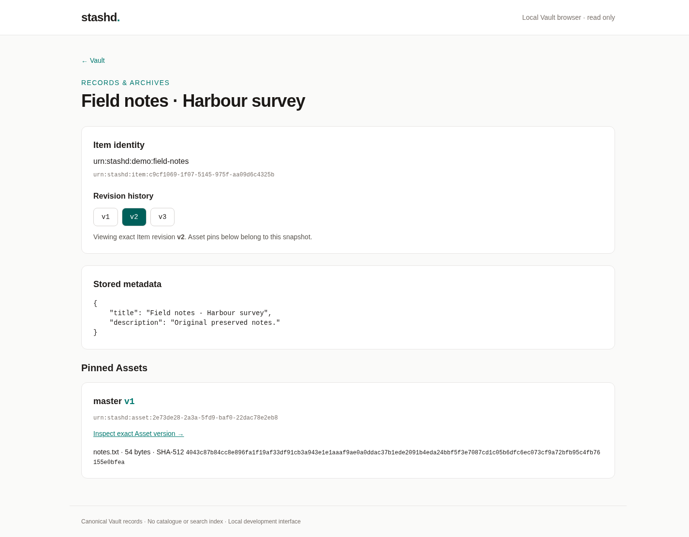
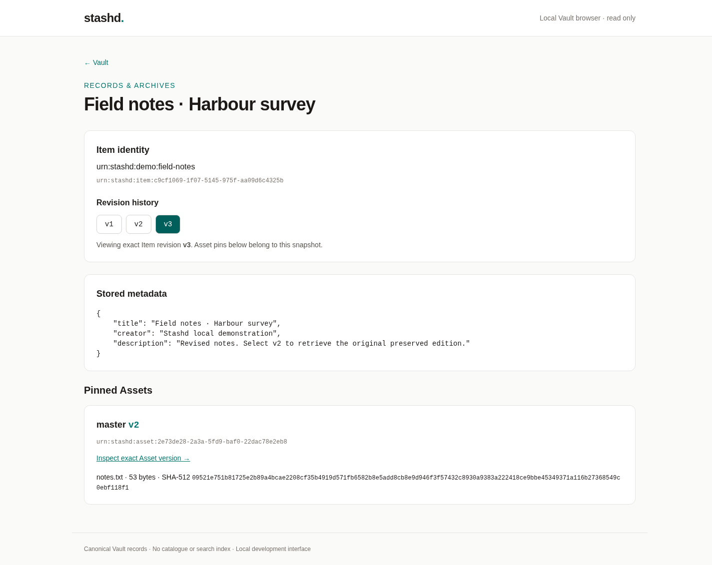
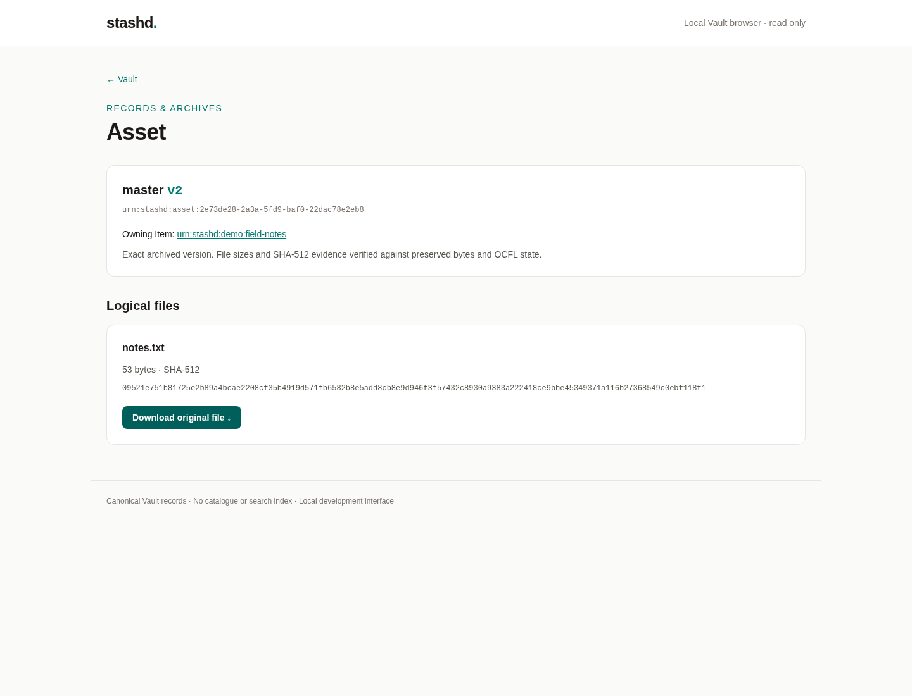

# Local Vault browser

Open `/` in the existing Tempest application. The browser reads the configured
canonical Vault directly through `Vault`, `ItemArchive` and `AssetArchive`.
No database, search service, catalogue, browser JavaScript or frontend build is
required. It is a local development interface, with no authentication or user
accounts. Keep it local; it is not a production dashboard.

## Launch with Lerd

From this Core checkout on the host:

```sh
lerd start                   # if Lerd is not already running
lerd link                    # once for a new checkout
lerd console key:generate    # once if Tempest's local signing/encryption keys are absent
lerd open
```

This checkout is linked at <https://core.test/>. For another checkout, use the
URL Lerd reports (including its configured DNS suffix). The document root is
`public/`; routes run through `public/index.php`. No worker is required.

Vault configuration is read only in `app/Administration/VaultConfig.config.php`:
`VAULT_PROVIDER=local`, `VAULT_ROOT` defaults to `storage/vault` in this checkout.
Set `VAULT_ROOT` in the local, ignored `.env` to browse an existing Vault. A shell
`export VAULT_ROOT=...` affects CLI commands in that shell, **not** the separately
running FPM web application. Give both the same path, visible inside Lerd.
Changing the setting requires fresh requests; use `lerd restart` if FPM retains
an old environment. The UI displays the resolved provider/root and Vault identity.
Do not initialize an existing or damaged Vault to clear a browser error.

For a genuinely new Vault, enter `lerd shell` and run `php tempest vault:init`.
Use the [connected CLI workflow](../../app/RecordsAndArchives/ItemArchive.md#runnable-connected-cli-demonstration)
to populate it: metadata-only Item v1, Item v2 → Asset v1, Item v3 → Asset v2.
Choose the same `VAULT_ROOT` for web and CLI before running the example. Asset
and Item commits are separate; each Item commit supplies its **complete** pin
snapshot. Existing Asset commits remain preserved if a later Item commit fails.
There are no browser write endpoints or multipart upload in this slice.

## Navigation and correctness

- `/`: enumerate `Vault::open()->listObjects()`, verify Item records and show
  title, canonical URI and OCFL head. Non-Item Objects and invalid Item records
  appear in Object notices. An unreadable OCFL inventory can stop enumeration;
  the page returns 503 and explicitly says no complete list is available.
- `/items/{object-id}?version=v2`: read that exact Item revision. An omitted
  version resolves the Item head once. Revision links never change stored pins.
  Each pin is inspected at its exact Asset version and checked for Item ownership.
  Unavailable pins stay visible as errors, without substituting another version.
- `/assets/{object-id}/{version}`: verified archival identity, owning Item,
  logical key, file inventory, byte counts and SHA-512 evidence.
- `/assets/{object-id}/{version}/download?path=...`: verified exact original
  bytes as `application/octet-stream`, attachment disposition with an encoded
  filename, `nosniff`, and `no-store`. The query contains a logical archive path,
  never a server source path. Missing, corrupt or invalid requests fail.

Download preparation calls production verified reads, streams to a private
`tmpfile()`, then independently verifies that copy before returning success.
It requires temporary disk capacity equal to the selected file and reads the
Asset several times. It uses bounded PHP memory; it does not promise instant
first-byte delivery, ranges or resumable downloads. The temporary file closes
and is removed after transmission or failure. A disconnected client can still
receive a partial transfer; the byte count detects failed transmission, and a
success cannot be replaced with an error after headers have already been sent.

`BrowserResponseSender` handles only `VerifiedDownload` and delegates normal
responses to Tempest. Tempest 3's default `Download` sender puts `readfile()`
inside an unbounded output buffer: a real 64 MiB/32 MiB HTTP proof exposed that
failure. The browser sender flushes buffers before sending the verified stream.
`BrowserExceptionRenderer` preserves explicit browser error pages in local mode.

This is a synchronous filesystem scan, without pagination or an index. It is
intended for development Vaults, not million-Item interactive browsing. Asset
inspection verifies all logical files in the selected Asset. External mutation
of the canonical Vault during requests remains outside the archive service's
immutability assumption. No repair, commit journal or crash recovery is added.

## UI assets

The committed `public/vault-browser.css` is compiled Tailwind CSS 4.1.18, with
source in `app/VaultBrowser/tailwind.css` and class usage in `browser.view.php`.
It has no CDN or runtime network dependency. Restyling can use a temporary
Tailwind CLI installation; no Node package or lockfile is added to Core.

## Verification, 21 October 2026

```sh
./bin/test.sh tests/Acceptance/RecordsAndArchives/VaultBrowserTest.php
./bin/test.sh tests/Acceptance/RecordsAndArchives
```

| Check | Passed | Failed | Incomplete |
| --- | ---: | ---: | ---: |
| Focused real HTTP browser tests | 3 | 0 | 0 |
| Records & Archives suite | 129 | 0 | 33 |

The HTTP tests start real Tempest web processes against disposable OCFL Vaults,
using production services to preserve fixtures. They traverse routes and the
actual response sender over TCP, restart the application, delete original
sources, compare independent SHA-512 hashes, reject invalid IDs/versions/paths,
escape metadata, and exercise missing/corrupt content and inventories. A 64 MiB
binary file downloads correctly with a **32 MiB server PHP memory limit**.
No internal services or persistence are mocked. Deliberately forcing every
historical pin to Asset v2 made the v2 → v1 HTTP proof fail at the exact Asset
link/hash assertion; restoration passed.

Production controller, download response, sender, initializer and error renderer
pass focused Mago static analysis. Changed PHP files pass formatting and lint.
`composer qa` was run and stops at the existing unsafe `finally` control flow in
`ObjectWriteLockTest`; unrelated automatic formatting was restored. Repository-wide analysis reports 951 errors, including existing archive typing
and Pest closure inference issues and the new untyped template/test contexts;
Mago does not infer the injected template variables or Pest fixture binding. The aggregate QA is not green.

The actual Lerd application was launched at <https://core.test/>, restarted,
and visited in installed headless Chromium. The UI's Item, revision, Asset and
download links were exercised, and browser downloads independently hashed.
All eight final page/download request lenses reported no issues; Chromium
reported no JavaScript exceptions and Lerd browser events contained navigation
events only. Screenshots below are actual pages, not mockups. Source files were deleted
before the browser run. Manual preserved example:

- Item: `urn:stashd:item:c9cf1069-1f07-5145-975f-aa09d6c4325b`.
- Asset: `urn:stashd:asset:2e73de28-2a3a-5fd9-baf0-22dac78e2eb8`.
- Item v2 → Asset v1: 54 bytes, SHA-512
  `4043c87b84cc8e896fa1f19af33df91cb3a943e1e1aaaf9ae0a0ddac37b1ede2091b4eda24bbf5f3e7087cd1c05b6dfc6ec073cf9a72bfb95c4fb76155e0bfea`.
- Item v3 → Asset v2: 53 bytes, SHA-512
  `09521e751b81725e2b89a4bcae2208cf35b4919d571fb6582b8e5add8cb8e9d946f3f57432c8930a9383a222418ce9bbe45349371a116b27368549c0ebf118f1`.






